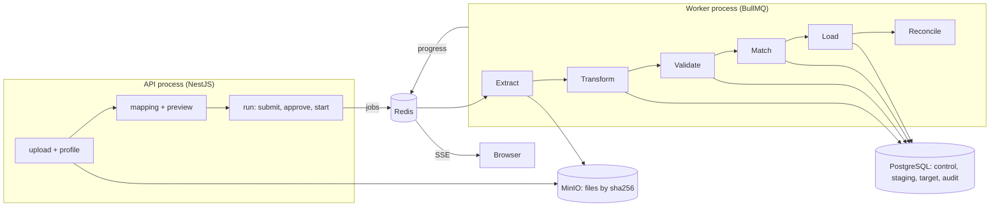

# Setu

Setu moves records from legacy Nepal government systems into a modern database, with proof at
every step: profiling, validation, quarantine with reasons, duplicate matching, lineage,
reconciliation reports and a tamper-evident audit log. Production loads need a second
person's approval, and every run can be rolled back.

All data in this repository is synthetic. The design is in
[docs/ARCHITECTURE.md](docs/ARCHITECTURE.md); the decisions behind it are in
[docs/adr](docs/adr).

## How a run works



Each stage handles batches of 1,000 rows in one transaction. Every row ends in exactly one
place: loaded, linked to a person already in target, quarantined with all its reasons, or held
for duplicate review. Rows are never dropped.

| Stage     | What it does                                                                                           |
| --------- | ------------------------------------------------------------------------------------------------------ |
| Extract   | Streams the file from MinIO into `staging.raw_rows`: CSV, Excel (.xlsx), XML or a SQL dump (see below) |
| Transform | Runs the pinned mapping: Preeti to Unicode, Devanagari digits, BS to AD, old VDC to local unit         |
| Validate  | Field rules and the row schema (dates, citizenship number format, ward within the unit)                |
| Match     | Compares with earlier rows and existing persons (district + birth year blocks, Jaro-Winkler)           |
| Load      | Inserts persons, households and lineage; dry runs stop before Match                                    |
| Reconcile | Counts, per-column checksums and a 1% field-by-field sample, saved as a report                         |

## Run it

Needs Node 22 and Docker.

```bash
cp .env.example .env
npm ci
docker compose up -d --wait            # Postgres 16, Redis 7, MinIO
npm run db:deploy                      # migrations
npm run db:seed                        # address reference data + one demo user per role
npm run start:api                      # http://localhost:3000, metrics on /metrics
npm run start:worker                   # metrics on :9464/metrics
curl localhost:3000/health/ready
```

Demo users are `operator@setu.local`, `reviewer@`, `approver@`, `auditor@` and `admin@`, all with
the password in `SEED_PASSWORD`. Generate a messy register with
`npm run generate:data -- --rows 1000 --seed 42 --encoding cp1252` (add `--format xlsx|xml|sql`
for the other formats).

### Source formats

| Kind    | Reads                                                                       | Notes                                                           |
| ------- | --------------------------------------------------------------------------- | --------------------------------------------------------------- |
| `csv`   | First row is the header                                                     | Encoding detected from the bytes                                |
| `excel` | First worksheet of an .xlsx; first non-empty row is the header              | Old .xls is refused: save as .xlsx or CSV                       |
| `xml`   | One record per child of the root; attributes and child elements are columns | Declared encoding honored; external entities never loaded       |
| `sql`   | `INSERT` rows of one table; columns from the INSERT or its `CREATE TABLE`   | Parsed, never executed; literal values only; one table per file |

A file that cannot be read as its format gets a failed profile with the reason.

## Tests

```bash
npm test                 # unit and property tests (pure transforms, rules, matching, hashing)
npm run test:int         # repositories and triggers against real Postgres (Testcontainers)
npm run test:e2e         # the API end to end, including a worker killed mid-run
npm run lint && npm run typecheck && npm run format:check
```

Integration and end-to-end tests start their own Postgres, Redis and MinIO containers; nothing
mocks the database.

## API

All routes are under `/api/v1`, JSON in and out, errors as RFC 9457 problem+json with the
request id in `X-Request-Id`.

| Area     | Routes                                                                                                                                                                                           |
| -------- | ------------------------------------------------------------------------------------------------------------------------------------------------------------------------------------------------ |
| Auth     | `POST /auth/login`, `POST /auth/refresh` (10 requests/min per IP), `GET /me`                                                                                                                     |
| Sources  | `POST /sources`, `POST /sources/:id/files`, `GET /files/:id/profile`                                                                                                                             |
| Mappings | `POST /sources/:id/mappings`, `GET /mappings/:id`, `POST /mappings/:id/preview`                                                                                                                  |
| Runs     | `POST /runs`, `/runs/:id/submit`, `/approve`, `/start`, `/pause`, `/resume`, `/cancel`, `/rollback`, `GET /runs/:id`, `GET /runs/:id/events` (SSE), `GET /runs/:id/reconciliation` (JSON or CSV) |
| Review   | `GET /quarantine`, `GET /matches`, `POST /matches/:id/decision`                                                                                                                                  |
| Records  | `GET /persons`, `GET /persons/:id` (`?calendar=bs`, `?unmask=true&reason=`), `GET /persons/:id/lineage`                                                                                          |
| Evidence | `GET /audit/events`, `GET /audit/verify`                                                                                                                                                         |
| Ops      | `GET /health/live`, `GET /health/ready`, `GET /metrics`                                                                                                                                          |

Roles: operators upload, map and run; approvers approve production runs and roll back;
reviewers decide duplicates; auditors read reports, lineage and the audit log. Citizenship
numbers are masked (`**-**-**-12345`) unless a reviewer or auditor unmasks one with a reason,
which is audited. Admin can neither approve nor unmask.

## Performance

Measured with k6 on one laptop (WSL2, 12 cores, 4 GB RAM), services in Docker, default
settings (batches of 1,000, concurrency 4). Details and method in
[ADR 6](docs/adr/0006-performance-tuning.md); how to rerun in [load/README.md](load/README.md).

|                                                     | Baseline          | After tuning           |
| --------------------------------------------------- | ----------------- | ---------------------- |
| 100,000-row production import (upload to completed) | 325 s, 308 rows/s | **94 s, 1,067 rows/s** |
| Match stage, mean per batch                         | 2.81 s            | 0.53 s                 |
| Person search p95, 20 concurrent users              | 53 ms             | 55 ms                  |

Every row of the 100,000 is accounted for: 76,536 loaded, 3,366 linked to an earlier record,
2,082 held for duplicate review, 18,016 quarantined with reasons. The main fix was narrowing
duplicate blocks to district + exact date of birth, which the scoring proves loses no match.

## Known limits

- Address reference data covers only the register's three districts (ADR 4); legacy ward
  numbers are stored as recorded, without a ward-level crosswalk.
- The app connects as the schema owner, so the INSERT-only role on `audit` and the daily
  chain-head checkpoint to MinIO are not built yet (ADR 3).
- Quarantined rows can be listed but not yet fixed and retried (`PATCH /quarantine/:id`,
  `POST /quarantine/retry`).
- No OpenAPI page (`/docs`), no `Idempotency-Key` header (run start is idempotent instead), no
  helmet or CORS allowlist yet.
- Rollback runs inside the API request.
